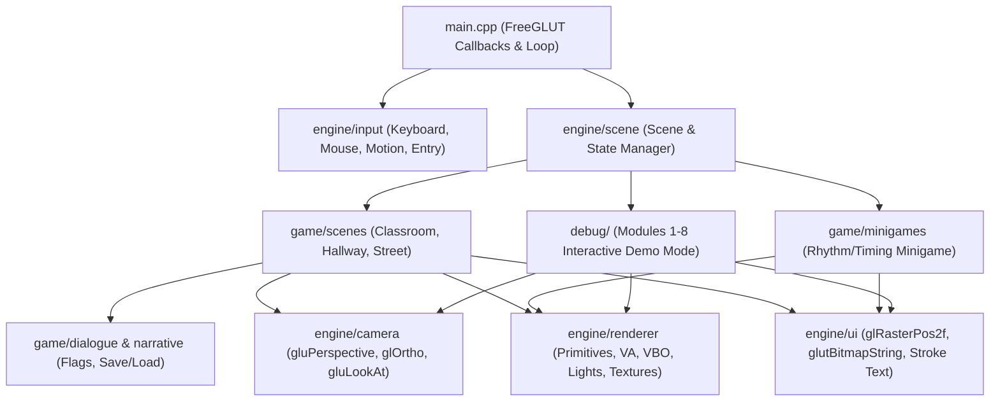

# Custom Game Framework Architecture

## 1. Architectural Philosophy

**Echoes of November** is an original 2.5D narrative adventure game built directly on **C++17** and **OpenGL (Compatibility Profile)** with **FreeGLUT** and **GLEW**.

In accordance with the project master plan:
- **No Heavyweight Engine:** The architecture avoids general-purpose engine bloat and uses focused, readable subsystems tailored for a 2.5D narrative game and academic defense.
- **Strict Separation of Concerns:** Rendering and OpenGL state management (`src/engine/renderer/`) are decoupled from gameplay, collision, and narrative progression (`src/game/`).
- **Full Coursework Visibility:** Every OpenGL module (Modules 1–8) is used both in actual gameplay scenes and in a dedicated interactive **Coursework Demonstration Mode** (`src/debug/`).

---

## 2. Project Directory Structure

```text
CS0045 finals/
├── CMakeLists.txt                  # CMake build configuration (MSYS2 UCRT64 GCC)
├── README.md                       # Setup, build, and runtime guide
├── .vscode/                        # VS Code tasks, launch, and IntelliSense config
├── docs/
│   ├── architecture.md             # System design and subsystem interactions
│   ├── opengl-module-coverage.md   # Traceability matrix for Modules 1–8
│   ├── controls.md                 # Player controls and debug/demo shortcuts
│   └── development-log.md          # Phase-by-phase progress and test log
├── src/
│   ├── main.cpp                    # GLUT entry point, callbacks, main loop
│   ├── engine/
│   │   ├── core/                   # Math utilities (4x4 matrices), timers, logging
│   │   ├── renderer/               # Primitives, Vertex Arrays, VBOs, Lighting, Materials
│   │   ├── camera/                 # 2.5D follow camera, gluLookAt, Ortho/Perspective
│   │   ├── input/                  # Keyboard & mouse state tracking via GLUT callbacks
│   │   ├── animation/              # Sprite-sheet UV animator & timer-driven tweens
│   │   ├── scene/                  # Scene interface and transition manager
│   │   ├── collision/              # 2.5D AABB floor-plane collision detection
│   │   ├── audio/                  # Lightweight audio wrapper
│   │   ├── assets/                 # Texture loader (stb_image) & procedural pixel art
│   │   └── ui/                     # GLUT bitmap/stroke text, HUD, dialogue & phone UI
│   ├── game/
│   │   ├── player/                 # Player controller, 2.5D billboard quad & states
│   │   ├── characters/             # NPC entities and animations
│   │   ├── dialogue/               # Branching dialogue parser and state machine
│   │   ├── interactions/           # Interactive world triggers and inspectables
│   │   ├── narrative/              # Story flags and save/load serialization
│   │   ├── minigames/              # Rhythm/timing minigame (Module 2/3/6/7 showcase)
│   │   └── scenes/                 # Classroom, Hallway, Rainy Street scenes
│   └── debug/                      # Interactive OpenGL Modules 1–8 Demo Mode & overlay
├── assets/
│   ├── sprites/                    # Character & NPC pixel-art sprite sheets (PNG)
│   ├── textures/                   # Environment textures (wood, tile, brick, window)
│   ├── models/                     # Reusable geometry definitions
│   ├── fonts/                      # Font metadata
│   ├── sounds/                     # Audio effects & ambient tracks
│   └── shaders/                    # Optional GLSL shaders
├── data/
│   ├── dialogue/                   # External dialogue scripts
│   ├── scenes/                     # Scene layout data
│   └── saves/                      # Save game slot files
└── tests/                          # Automated unit tests for non-graphical systems
```

---

## 3. Subsystem Interaction Diagram



---

## 4. Rendering Pipeline & 2.5D Presentation Strategy

1. **3D Environment Pass (`gluPerspective` + `GL_DEPTH_TEST` + `GL_LIGHTING`):**
   - Camera positioned via `gluLookAt()` with gentle horizontal tracking and subtle parallax.
   - Room walls, floors, desks, windows, and props rendered using **Vertex Arrays (Module 4)** and **VBOs / Indexed VBOs (Module 5)** with **Phong Lighting and Texture Mapping (Module 8)**.
2. **2.5D Character & Prop Pass (`GL_TEXTURE_2D` + `GL_NEAREST` + Alpha Blending):**
   - Characters are rendered as upright textured quads in 3D space (`glTranslatef`, `glScalef`) with `GL_NEAREST` filtering to preserve crisp pixel-art edges and `GL_BLEND` (`GL_SRC_ALPHA`, `GL_ONE_MINUS_SRC_ALPHA`) plus alpha testing so depth sorting with 3D furniture is accurate.
3. **Atmospheric Effects Pass (Modules 2, 5, 6):**
   - Sunbeams (`GL_TRIANGLE_FAN` with vertex alpha), dust motes (`GL_POINTS`), rain streaks (`GL_LINES`), dashed indicators (`GL_LINE_STIPPLE`), and dynamic puddle ripples (`glMapBuffer` + 4x4 matrix vertex updates).
4. **2D UI & Narrative Overlay Pass (`glOrtho` / `gluOrtho2D` with `GL_DEPTH_TEST` disabled):**
   - Dialogue boxes, character portraits, branching choices, phone messaging UI, and debug overlays rendered in screen space using `glBegin`/`glEnd` quads/line loops and `glRasterPos2f` + `glutBitmapString`.
